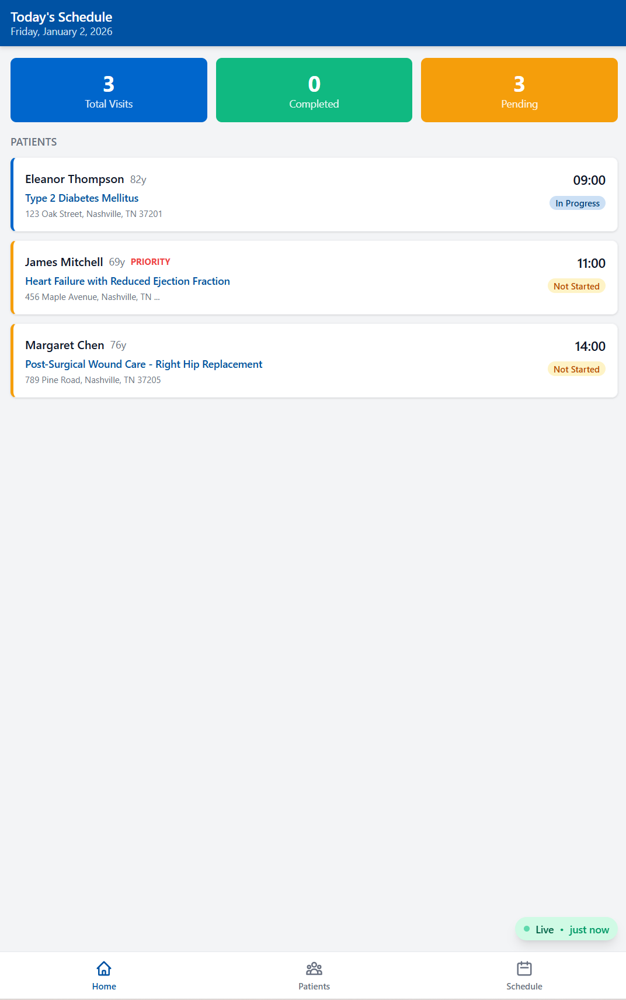
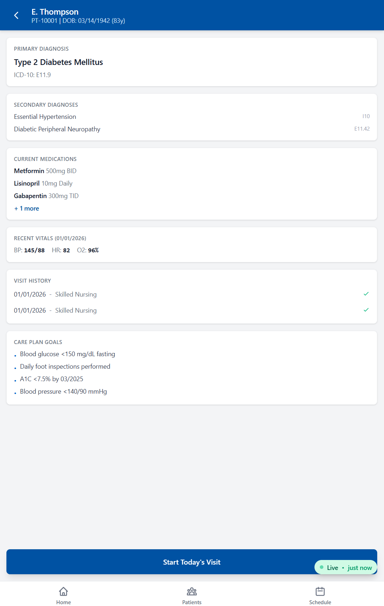

# Ratchet EMR Dashboard

**Live Demo:** [pointcare-emr-demo.netlify.app](https://pointcare-emr-demo.netlify.app)

Mobile-first EMR dashboard for home health nurses, designed to display clinical documentation populated by [Ratchet MCP](https://github.com/m2ai-mcp-servers/mcp-ratchet-clinical-charting) via Claude.

> **DEMO** — This is a demonstration application using synthetic patient data (Agatha Christie characters). Not for clinical use.

## Screenshots

| Today's Schedule | Patient Detail |
|-----------------|----------------|
|  |  |

## How It Works

```
Nurse dictates visit notes
        |
        v
Claude Desktop + Ratchet MCP
  (natural language -> structured clinical data)
        |
        v
    Supabase (PostgreSQL)
        |
        v
  EMR Dashboard (this app)
  - Polls every 2 seconds
  - Changed fields highlight yellow
  - "Live - Updated Xs ago" indicator
```

A home health nurse dictates visit notes in natural language through Claude Desktop. Ratchet MCP parses the dictation into structured clinical data (vitals, SOAP notes, interventions, education) and writes it to Supabase. This dashboard displays the data in real-time with field-level change highlighting.

## Features

- **Real-time updates** — 2-second polling with yellow highlight animation on changed fields
- **Mobile-first tablet design** — optimized for 768-1024px with 44px touch targets
- **Full visit documentation** — Vitals, SOAP notes, medications, care plan, education checklists
- **Auto-fallback** — uses local JSON data if Supabase is unavailable
- **Clinical vitals thresholds** — color-coded normal/borderline/critical ranges

## Tech Stack

- React 19 + React Router 7
- Tailwind CSS v4
- Supabase (PostgreSQL + REST API)
- Vite 7
- Deployed on Netlify

## Quick Start

```bash
git clone https://github.com/m2ai-mcp-servers/ratchet-demo-emr.git
cd ratchet-demo-emr
npm install
npm run dev
```

The app runs with local JSON data by default. To connect to Supabase:

```bash
cp .env.example .env
# Edit .env with your Supabase credentials:
# VITE_SUPABASE_URL=https://your-project.supabase.co
# VITE_SUPABASE_ANON_KEY=your-anon-key
```

## Project Structure

```
src/
  components/
    layout/        Header, NavBar
    common/        Badge, Card, LoadingSpinner
    clinical/      VitalsPanel, SOAPNote, checklists
    demo/          DataRefreshIndicator
  pages/
    Dashboard      Today's patient schedule
    Patients       Patient list
    PatientDetail  Patient profile + history
    VisitDocumentation  Primary demo screen (vitals, SOAP, meds, plan)
    Schedule       Calendar view
  hooks/           usePolling, usePatients, useVisits
  services/
    supabase.js    Supabase client
    dataService.js Data layer (auto-switches Supabase/JSON)
  utils/           constants, formatters
```

## Related Projects

- **[Ratchet MCP Server](https://github.com/m2ai-mcp-servers/mcp-ratchet-clinical-charting)** — The MCP server that populates this dashboard via Claude
- **[Ratchet Integration Guide](docs/RATCHET-INTEGRATION.md)** — API reference for connecting Ratchet to this dashboard

## License

MIT
